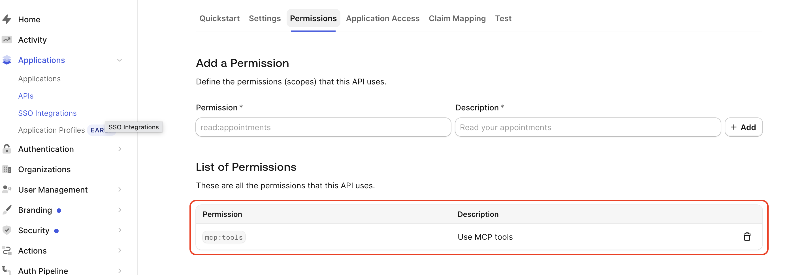
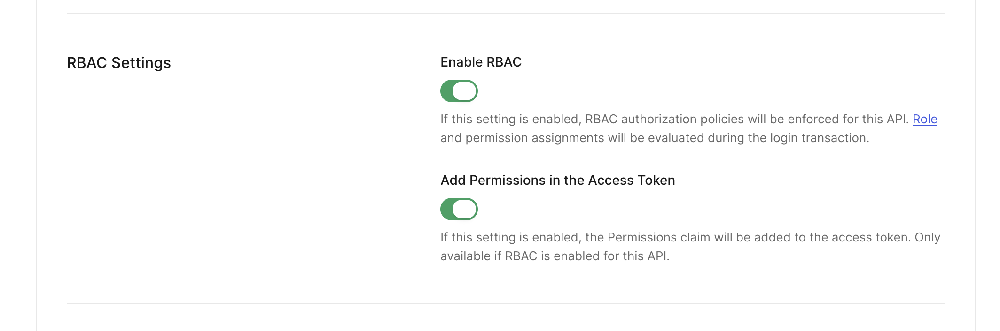
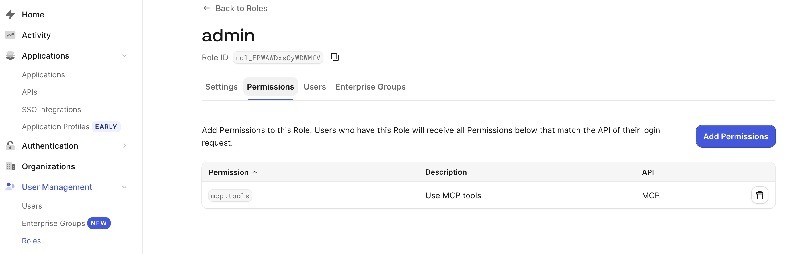
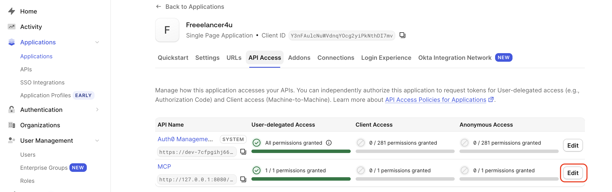
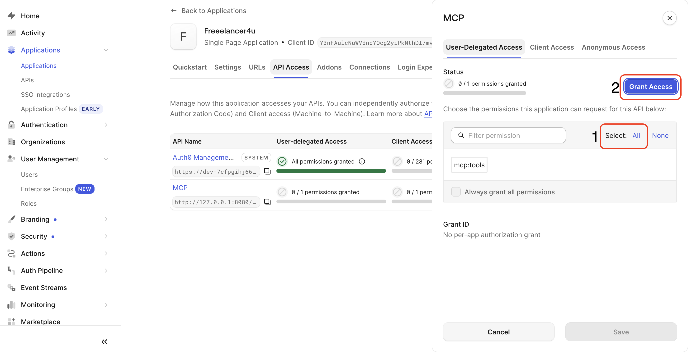

# 3SE2 - Übung 11

**Themen:** Spring AI, KI-generierte Jobtitel, Tool Calling, MCP und ein Chatfenster mit SvelteKit

In dieser Übung erweiterst du Freelancer4u um KI-generierte Jobtitel und einen Chat. Zuerst bindest du ein Modell an und erzeugst damit auch einen Demo-Job als JSON. Danach ergänzt du zwei Java-Methoden, mit denen der Chat Jobs suchen und erstellen kann. Am Schluss rufst du dieselben Methoden über MCP aus VS Code auf.

Folgendes wird erwartet.

- Der Endpunkt `GET /api/job/randomjob` liefert einen KI-generierten Demo-Job als JSON.
- Beim Erstellen eines Jobs über das bestehende Formular wird der Titel anhand der Beschreibung angepasst.
- Im Frontend können angemeldete Benutzerinnen und Benutzer das Chatfenster öffnen und damit Jobs suchen und erstellen.
- In VS Code kannst du dieselben Tools über MCP aufrufen. Ein so erstellter Job erscheint anschliessend auch in Freelancer4u.

## Ausgangslage

Starte mit deinen bisherigen Lösungen. Wenn du mit der Musterlösung arbeitest, verwende die folgenden Stände **vor Übung 11**. Vergesse dabei nicht die `.env` Datein im Front und Backend anzupassen.

## Die Übung darf alternativ im Einzelprojekt umgesetzt werden.
Folgendes wird erwartet.
- Im Backend muss ein sinnvoller Use Case umgesetzt werden, welcher die API von OpenAI aufruft.
- Im Frontend muss ein Chat erstellt werden, wobei der Chat auf Tools im backend zugreifen kann.
- (optinal) Die Tools müssen über MCP an MCP Clients (zB. Visual Studio Code Copilot) zur verfügung gestellt werden.
- (optinal) Ein MCP Client muss mit dem Endpoint eingerechetet werden.
- (optinal) Der MCP Endpoint muss via Auth0 gesichert sein.

## OpenAI API Gateway

Wir verwenden ein OpenAI-API-Gateway, über das API-Schlüssel bereitgestellt werden. Euren persönlichen Schlüssel findet ihr auf Moodle. Für die Nutzung gilt ein Token-Limit pro Stunde. Wenn ihr stattdessen euren eigenen OpenAI-API-Schlüssel verwenden möchtet, kommentiert in der Datei `application.properties` die Zeile `spring.ai.openai.base-url` aus und tragt euren Schlüssel in der `.env`-Datei in der Variable `OPENAI_API_KEY` ein.

## Teil 1 - Spring AI einrichten

**a)** Ergänze in der Backend-`pom.xml` unter `<properties>` die Version `<spring-ai.version>2.0.2</spring-ai.version>`. Füge direkt vor dem bestehenden `<dependencies>`-Block den folgenden Block ein.

```xml
<dependencyManagement>
    <dependencies>
        <dependency>
            <groupId>org.springframework.ai</groupId>
            <artifactId>spring-ai-bom</artifactId>
            <version>${spring-ai.version}</version>
            <type>pom</type>
            <scope>import</scope>
        </dependency>
    </dependencies>
</dependencyManagement>
```

Füge die folgenden beiden Abhängigkeiten in den bestehenden `<dependencies>`-Block ein. Die BOM legt die Versionen fest.

```xml
<dependency>
    <groupId>org.springframework.ai</groupId>
    <artifactId>spring-ai-starter-model-openai</artifactId>
</dependency>
<dependency>
    <groupId>org.springframework.ai</groupId>
    <artifactId>spring-ai-starter-mcp-server-webmvc</artifactId>
</dependency>
```


**b)** Ergänze in `src/main/resources/application.properties` die folgenden Einstellungen. Behalte die vorhandenen Einträge für MongoDB und Auth0 bei.

```properties
spring.ai.model.chat=openai
spring.ai.openai.api-key=${OPENAI_API_KEY}
spring.ai.openai.chat.model=${OPENAI_MODEL:gpt-5-nano}
spring.ai.mcp.server.enabled=true
spring.ai.mcp.server.protocol=STREAMABLE
spring.ai.model.embedding=none
spring.ai.model.image=none
spring.ai.model.audio.speech=none
spring.ai.model.audio.transcription=none
spring.ai.model.moderation=none
spring.ai.openai.base-url=https://llm-gateway.91.98.233.101.sslip.io/v1
logging.level.org.springframework.ai.chat.client.advisor.SimpleLoggerAdvisor=DEBUG
```


**c)** Füge die Variable `OPENAI_API_KEY` in die `.env` Datei und setze dort dein API Key, welchen du auf Moodle findest. Einen anderen Modellnamen kannst du über `OPENAI_MODEL` setzen. 


**d)** Lege [ChatClientConfig.java](ChatClientConfig.java) im Paket `ch.zhaw.freelancer4u.config` ab. Spring AI stellt einen `ChatClient.Builder` bereit. Die Konfiguration baut daraus eine `ChatClient`-Bean mit `SimpleLoggerAdvisor`. Klassen mit `@RequiredArgsConstructor` können die Bean über ein `final`-Feld injizieren lassen.

## Teil 2 - Jobtitel und Demo-Jobs generieren

**a)** Lege [JobTitleGenerator.java](JobTitleGenerator.java) im Java-Paket `ch.zhaw.freelancer4u.controller` ab. Die Klasse erhält den `ChatClient` aus `ChatClientConfig` über den von Lombok erzeugten Konstruktor. `.system(...)` gibt die Anweisung für das Modell vor, `.user(...)` übergibt Titel und Beschreibung und `.content()` liefert den Antworttext.

**b)** Ergänze in `JobController` das Feld `private final JobTitleGenerator jobTitleGenerator;`. Rufe nach dem Erstellen des `Job`-Objekts und vor dem Speichern Folgendes auf.

```java
jDAO.setTitle(jobTitleGenerator.generate(jDAO.getTitle(), jDAO.getDescription()));
```

**c)** Melde dich mit einem Admin-Konto an und erstelle einen Job über das bestehende Formular. Prüfe den gespeicherten Titel. Bei einem Modellfehler behält der Generator den eingegebenen Titel bei.

**d)** Ergänze in `JobController` den Import `org.springframework.ai.chat.client.ChatClient` und das Feld `private final ChatClient chatClient;`. Der vorhandene `@RequiredArgsConstructor` übernimmt die Injektion. Füge diese Methode hinzu.

```java
@GetMapping("/randomjob")
public ResponseEntity<Job> randomJob() {
    Job randomJob = chatClient.prompt("Create a random job")
            .call()
            .entity(Job.class);
    return ResponseEntity.status(HttpStatus.OK).body(randomJob);
}
```

`.entity(Job.class)` wandelt die Modellantwort in ein Java-Objekt um. Teste `GET http://localhost:8080/api/job/randomjob` mit dem Bearer-Token.

## Teil 3 - Zwei Tools für den Chat bereitstellen

**a)** Lege [FreelancerTools.java](FreelancerTools.java) und [FreelancerToolConfig.java](FreelancerToolConfig.java) im Paket `ch.zhaw.freelancer4u.tools` ab. `@Tool` beschreibt die Methoden für Spring AI. Der `ToolCallbackProvider` registriert beide Methoden.

**b)** Ergänze im `CompanyRepository` die Methode `Optional<Company> findFirstByNameIgnoreCase(String name);` und importiere `java.util.Optional`. Ergänze im `JobRepository` die folgende Methode und importiere `ch.zhaw.freelancer4u.model.JobState`.

```java
List<Job> findByJobStateAndTitleContainingIgnoreCaseOrJobStateAndDescriptionContainingIgnoreCase(
        JobState titleState, String title, JobState descriptionState, String description, Pageable pageable);
```

**c)** Lege [ChatController.java](ChatController.java) im Paket `ch.zhaw.freelancer4u.controller` ab. Der Controller stellt `POST /api/chat` bereit. Er baut einen eigenen ChatClient mit Systemprompt, Freelancer-Tools, `MessageChatMemoryAdvisor` und `SimpleLoggerAdvisor`. Der Memory-Advisor verwaltet den jüngsten Verlauf pro angemeldeter Person und Konversations-ID. Der Verlauf liegt standardmässig im Arbeitsspeicher des Backends. Das Modell kann einen Tool-Aufruf anfordern. Spring AI führt die Java-Methode aus und gibt das Ergebnis an das Modell zurück.

## Teil 4 - Chatfenster im Frontend einbauen

| Vorlage | Ziel im Frontend-Repository |
| --- | --- |
| [JobChat.svelte](JobChat.svelte) | `src/lib/JobChat.svelte` |
| [+server.js](+server.js) | `src/routes/api/chat/+server.js` |

Importiere in `src/routes/+layout.svelte` die Komponente mit `import JobChat from "#lib/JobChat.svelte";`. Ergänze unter dem Seiteninhalt:

```svelte
{#if isAuthenticated}
  <JobChat />
{/if}
```

Starte das Backend und das Frontend (`npm run dev`). Melde dich an und öffne den Chat unten rechts. Frage zum Beispiel «Welche offenen Java-Jobs gibt es?». Das Modell fordert bei Bedarf einen Aufruf von `search_jobs` an. Du kannst auch über den Chat einen Job erstellen. Dazu ruft das Modell bei Bedarf das Tool `create_job` auf.

## Teil 5 – Die Tools `search_jobs` und `create_job` im Backend als MCP-Server bereitstellen

Der WebMVC-Starter veröffentlicht die registrierten Tool-Callbacks am MCP-Endpunkt. Ergänze im Backend in `SecurityConfig` die folgende Filterkette und füge die im Beispiel gezeigten Imports hinzu. Der Endpunkt dient der lokalen Übung und kann Jobs schreiben.

```java
import java.net.URI;
import org.springframework.beans.factory.annotation.Value;
import org.springframework.core.annotation.Order;
import org.springframework.security.config.http.SessionCreationPolicy;
import org.springframework.security.oauth2.jwt.BadJwtException;
import org.springframework.security.oauth2.jwt.JwtDecoder;
import org.springframework.security.oauth2.server.resource.web.BearerTokenAuthenticationEntryPoint;
```

```java
@Bean
@Order(1)
public SecurityFilterChain mcpFilterChain(HttpSecurity http, JwtDecoder jwtDecoder,
        @Value("${spring.security.oauth2.resourceserver.jwt.issuer-uri}") String issuer,
        @Value("${freelancer.mcp.resource-url}") URI resource) throws Exception {
    String metadataPath = "/.well-known/oauth-protected-resource/mcp";
    var entryPoint = new BearerTokenAuthenticationEntryPoint();
    entryPoint.setResourceMetadataParameterResolver(request -> resource.resolve(metadataPath).toString());

    return http.securityMatcher("/mcp", metadataPath)
            .authorizeHttpRequests(authorize -> authorize
                    .requestMatchers(metadataPath).permitAll()
                    .anyRequest().hasAuthority("SCOPE_mcp:tools"))
            .sessionManagement(session -> session.sessionCreationPolicy(SessionCreationPolicy.STATELESS))
            .csrf(csrf -> csrf.disable())
            .oauth2ResourceServer(oauth2 -> oauth2
                    .authenticationEntryPoint(entryPoint)
                    .protectedResourceMetadata(metadata -> metadata.protectedResourceMetadataCustomizer(builder ->
                            builder.resource(resource.toString()).authorizationServer(issuer).scope("mcp:tools")))
                    .jwt(jwt -> jwt.decoder(token -> {
                        var decoded = jwtDecoder.decode(token);
                        var audiences = decoded.getAudience();
                        if (audiences == null || !audiences.contains(resource.toString())) {
                            throw new BadJwtException("The token audience does not match this MCP server.");
                        }
                        return decoded;
                    })))
            .build();
}
```

### Auth0 für den MCP-Endpunkt einrichten

Verwende denselben Auth0-Tenant wie für Freelancer4u. In diesem Teil registrierst du den MCP-Endpunkt als API und verwendest eine Auth0-Anwendung für die Anmeldung aus VS Code. Teils der folgenden Bilder stammen aus Auth0-Beispielen. Verwende beim Einrichten die Werte aus der Übung.

**Hinweis:** Für das Deployment musst du die Schritte b) bis d) mit deinem bereitgestellten Endpunkt wiederholen. Ersetze ausserdem in der `.env`-Datei den Wert der Variable `MCP_RESOURCE_URL` durch die URL deines bereitgestellten MCP-Endpunkts.

**a)** Öffne im Auth0-Dashboard in der linken Navigation **Settings → Advanced**. Aktiviere **Resource Parameter Compatibility Profile** und speichere. VS Code sendet die MCP-Adresse als `resource`. Mit dieser Einstellung verwendet Auth0 die Adresse als Audience des Zugriffstokens. Für diese Übung wird der Client über seine vorhandene Client ID angegeben.


[Bildquelle und Erklärung von Auth0](https://auth0.com/blog/secure-csharp-mcp-server-with-auth0/#configure-your-auth0-tenant)

**b)** Wähle **Applications → APIs → Create API**. Gib als Name zum Beispiel `Freelancer4u MCP` an und verwende als **Identifier** exakt `http://127.0.0.1:8080/mcp`. Belasse den Signaturalgorithmus bei **RS256**.


Öffne bei der neuen API **Permissions** und füge unter `Add a Permission` `mcp:tools` hinzu. 


Bei der neuen API aktiviere unter **Settings → RBAC Settings** die Option **Enable RBAC** und **Add Permissions in the Access Token** und speichere. Spring prüft den Scope im Zugriffstoken.


**c)** Öffne **User Management → Roles → admin → Permissions → Add Permissions**. Wähle die neue MCP-API und `mcp:tools` aus. Prüfe unter **User Management → Users → dein Testkonto → Roles**, ob dem Konto bereits `admin` zugewiesen ist. Mit dieser Konfiguration können sich Benutzerinnen und Benutzer mit dieser Rolle mit dem MCP-Server verbinden.



**d)** Öffne unter **Applications → [Deine Applikation]**. Wähle den Tab **URLs** und unter **Allowed Callback URLs** füge `http://127.0.0.1:33418/` und `https://vscode.dev/redirect` hinzu.

In der gleichen Application im Tab **API Access**, drücke auf edit bei deiner MCP API.


Wähle `all` und `Grant Access`.



**e)** Ergänze den MCP-Resource-Identifier in `src/main/resources/application.properties`. `AUTH0_DOMAIN` bleibt die Domain des Tenants aus dem bisherigen Backend-Setup.

```properties
freelancer.mcp.resource-url=${MCP_RESOURCE_URL:http://127.0.0.1:8080/mcp}
```

Vergleiche vor dem Test drei Werte: den **Identifier** der Auth0-API, die **Resource-URL** im Backend und die **URL** im VS-Code-Eintrag. Für den lokalen Test müssen alle drei genau `http://127.0.0.1:8080/mcp` sein.

### MCP-Server in VS Code hinzufügen und testen

**Hinweis:** Falls beim Einrichten nach der **Client ID** nachgefragt wird, verwende die aus Schritt d) der Auth0-Anleitung.

<video controls src="img/setup_mcp.mov" title="Title"></video>


**a)** Prüfe im Copilot-Chat, ob `search_jobs` und `create_job` verfügbar sind. Frage zuerst «Suche mit dem Freelancer4u-Tool nach offenen Java-Jobs». Rufe danach `create_job` mit einem Demo-Auftrag auf, zum Beispiel «Erstelle den Job Java-API implementieren bei Demo AG für 500 mit Jobtyp IMPLEMENT und der Beschreibung REST-Endpunkt entwickeln». Falls die Firma fehlt, legt das Tool sie an. Suche den Job danach im Chatfenster von Freelancer4u und prüfe nach dem Neuladen auch die Jobs-Seite.

Die beiden Tools definieren, **was** Freelancer4u ausführen kann. MCP definiert, **wie** VS Code diese Tools entdeckt und aufruft.

### Deployment
Für das Deployment müssen die neuen Variablen (`MCP_RESOURCE_URL` und `OPENAI_API_KEY`) in GitHub unter **Settings → Secrets and variables → Actions** als Repository-Secrets hinterlegt werden.

Wie oben bereits erwähnt, muss die Auth0-Konfiguration für den bereitgestellten MCP-Endpunkt wiederholt werden.

## Abgabe

Pushe deine Änderungen in deine privaten GitHub-Repositories für Frontend und Backend. Gib beide Repositories für die Dozierenden frei und reiche die beiden URLs auf Moodle ein. Zugangsdaten bleiben in deiner lokalen Umgebung.

[Spring AI OpenAI Chat](https://docs.spring.io/spring-ai/reference/api/chat/openai-chat.html) · [Spring AI MCP über WebMVC](https://docs.spring.io/spring-ai/reference/api/mcp/mcp-overview.html#_webmvc)
