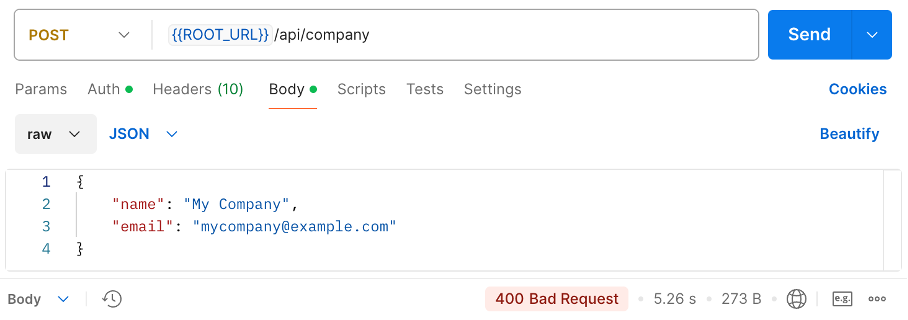

# 3SE2 – Übung 12

**Themen:** Anbindung von Drittsystemen, E-Mail-Validierung, E-Mail-Versand und Code-Analyse

In dieser Übung prüfst du das Format der E-Mail-Adresse im Company-Formular. Das Java-Backend prüft die Adresse beim Aufruf von `POST /api/company` mit Disify. Danach verschickst du beim Selbstzuweisen und Abschliessen eines Jobs eine Nachricht mit dem neuen Status. Im letzten optionalen Teil analysierst du das Backend mit SonarQube Cloud.

## Ausgangslage

Starte mit deinen bisherigen Lösungen. Wenn du mit der Musterlösung arbeitest, verwende die folgenden Stände **vor Übung 12**. Vergesse dabei nicht die `.env` Datein im Front und Backend anzupassen.

## Die Übung darf alternativ im Einzelprojekt umgesetzt werden.
Folgendes wird erwartet.
- Im Backend muss ein Drittsystem angebunden werden.
- (optional) Bei einem Use-Case wird ein Email versendet.
- (optional) Das Backend wird via SonarQube analysiert.


## Teil 1 – E-Mail-Adressen prüfen

**a)** Teste die Disify-API zuerst direkt in Postman.

1. Erstelle einen Request mit **POST** und der URL `https://disify.com/api/email`.
2. Wähle unter **Authorization** die Option **No Auth**.
3. Wähle unter **Body** die Option **x-www-form-urlencoded**. Gib als **Key** `email` und als **Value** `user@disposable-inbox.test` ein. Postman kodiert den Wert und setzt den passenden Content-Type.
4. Klicke **Send** und lies das JSON. HTTP 200 bedeutet, dass Disify die Prüfung ausgeführt hat. Die Beispieladresse wird als temporär erkannt. Akzeptiert wird eine Adresse in dieser Übung, wenn `format` und `dns` auf `true` und `disposable` auf `false` stehen. Mail-DNS bestätigt die Domain. Ob das einzelne Postfach existiert, wird dabei nicht geprüft. [Disify Single Email Check](https://docs.disify.com/api/email.html)

**b)** Das Company-Formular in `src/routes/companies/+page.svelte` verwendet für die E-Mail-Adresse bereits ein Pflichtfeld mit `type="email"`. Der Browser kann dadurch einfache Eingabefehler direkt anzeigen. Diese Validierung kann jedoch vom User umgangen werden aus diesem Grund, wird eine Email Validierung im Backend umgesetzt. 

**c)** Ergänze in der `pom.xml` im Backend in `<dependencies>` den WebClient-Starter. Spring Boot stellt damit einen `WebClient.Builder` bereit, während das Backend Spring MVC verwendet. [Spring Boot WebClient](https://docs.spring.io/spring-boot/reference/io/rest-client.html#io.rest-client.webclient)

```xml
<dependency>
    <groupId>org.springframework.boot</groupId>
    <artifactId>spring-boot-starter-webclient</artifactId>
</dependency>
```

Ergänze in `src/main/resources/application.properties`:

```properties
freelancer.disify.base-url=${DISIFY_BASE_URL:https://disify.com}
```

Kopiere die folgenden Klassen nach `src/main/java/ch/zhaw/freelancer4u/` in die angegebenen Pakete.

| Datei | Paket |
| --- | --- |
| [MailInformation.java](MailInformation.java) | `model` |
| [MailValidationConfig.java](MailValidationConfig.java) | `service` |
| [MailValidatorService.java](MailValidatorService.java) | `service` |

`MailValidationConfig` stellt den konfigurierten `WebClient` als Spring-Bean bereit. In `MailValidatorService` erzeugt Lombok mit `@RequiredArgsConstructor` einen Konstruktor für das Feld `private final WebClient disifyClient`. Spring übergibt diesem Konstruktor die Bean automatisch. Nur das Java-Backend ruft Disify auf und entscheidet, ob eine Adresse gespeichert werden darf. Diese Prüfung gilt auch für direkte Aufrufe des REST-Endpunkts.

**d)** Importiere `ch.zhaw.freelancer4u.service.MailValidatorService` im `CompanyController` und ergänze `private final MailValidatorService mailValidatorService;`. Ersetze in `createCompany` nach der bestehenden Rollenprüfung die Zeile, die das `Company`-Objekt erstellt, durch diesen Block:

```java
String email = fDTO.getEmail();
if (!mailValidatorService.isValid(email == null ? null : email.strip())) {
    return new ResponseEntity<>(HttpStatus.BAD_REQUEST);
}

Company fDAO = new Company(fDTO.getName(), email.strip());
```

**e)** Teste den REST-Endpunkt direkt in Postman. Damit prüfst du die Validierung im Spring-Backend unabhängig vom SvelteKit-Formular.

1. Starte das Backend und melde dich im lokalen Frontend mit dem Admin-Testkonto an. Öffne die Entwicklerwerkzeuge des Browsers und suche in der Cookie-Ansicht des Frontends nach `jwt_token`. Kopiere den Wert für deinen lokalen Test. Gib das Token weder weiter noch in eine geteilte Postman-Collection ein.
2. Erstelle einen Request mit **POST** und der URL `http://127.0.0.1:8080/api/company`. Passe Host und Port an, falls dein Backend woanders läuft.
3. Wähle unter **Authorization** die Option **Bearer Token** und füge den Cookie-Wert ins Feld **Token** ein. Postman ergänzt den Präfix `Bearer`. [Bearer-Token in Postman](https://learning.postman.com/docs/use/send-requests/authorization/authorization-types/#bearer-token)
4. Wähle unter **Body → raw** als Format **JSON**. Sende folgende Daten.

```json
{
  "name": "Demo AG",
  "email": "user@disposable-inbox.test"
}
```

| Test | Erwartetes Ergebnis |
| --- | --- |
| Temporäre Testadresse aus dem Beispiel | `400 Bad Request`. Die Company wird nicht gespeichert. |
| Eigene, von Disify akzeptierte Testadresse | `201 Created`. Die Antwort enthält die erstellte Company. Prüfe die Liste im Frontend oder rufe `GET /api/company` mit demselben Token auf. |
| Disify ist nicht erreichbar oder meldet `dns_indeterminate` | `503 Service Unavailable`. Wiederhole den Versuch später. Die Company wird nicht gespeichert. |

Der Screenshot zeigt den POST-Request mit JSON und die Antwort `400 Bad Request`. Verwende für den Test die Adresse aus dem JSON-Beispiel oben.



**f)** Passe im Frontend die Aktion `createCompany` in `src/routes/companies/+page.server.js` an. Entferne Leerzeichen am Anfang und Ende der E-Mail-Adresse, bevor du die Formulardaten an das Java-Backend sendest.

```js
const company = {
    name: data.get('name'),
    email: String(data.get('email') ?? '').trim()
};
```

Passe den `catch`-Block nach dem Aufruf von `POST /api/company` an. Bei `400` bittet das Formular um eine andere Adresse. Bei `503` bittet es darum, es später noch einmal zu versuchen. Die Seite in `src/routes/companies/+page.svelte` zeigt die Meldung bereits über `form.error` an.

```js
} catch (failure) {
    const status = axios.isAxiosError(failure) ? failure.response?.status : undefined;
    if (status === 400) {
        return fail(400, { error: 'Use a valid, non-disposable company email address.' });
    }
    if (status === 503) {
        return fail(503, { error: 'Email validation is unavailable. Try again later.' });
    }
    return fail(502, { error: 'Could not create company.' });
}
```

Teste im Company-Formular eine Adresse mit fehlerhaftem Format, eine syntaktisch gültige Einwegadresse und eine akzeptierte Testadresse. Bei der Einwegadresse zeigt das Formular den Fehler aus dem Backend an. [Disify-Fehlerbehandlung](https://docs.disify.com/api/errors.html)

### Warum braucht es eine Prüfung im Backend?

`type="email"` prüft im Browser das Format der Eingabe. Das Attribut `required` verhindert, dass das Feld leer bleibt. Eine Einwegadresse kann trotzdem ein gültiges Format haben. Ausserdem kann ein Client wie Postman den REST-Endpunkt direkt aufrufen und damit die Formularprüfung umgehen.

Spring Boot prüft deshalb vor dem Speichern mit Disify das Format, die Mail-DNS-Einträge der Domain und Hinweise auf Einwegadressen. Ob das einzelne Postfach existiert oder der Person gehört, lässt sich daraus nicht ableiten.

### Backend-Tests anpassen

Die Tests sollen auch ohne echte Auth0- und OpenAI-Zugangsdaten laufen. Übernimm dazu die folgenden Dateien aus der Musterlösung in das Backend.

| Vorlage | Ziel im Backend |
| --- | --- |
| [application-test.properties](application-test.properties) | `src/test/resources/application-test.properties` |
| [Freelancer4uApplicationTests.java](Freelancer4uApplicationTests.java) | `src/test/java/ch/zhaw/freelancer4u/Freelancer4uApplicationTests.java` |
| [CompanyControllerTest.java](CompanyControllerTest.java) | `src/test/java/ch/zhaw/freelancer4u/controller/CompanyControllerTest.java` |
| [JobControllerTest.java](JobControllerTest.java) | `src/test/java/ch/zhaw/freelancer4u/controller/JobControllerTest.java` |

- **Testprofil.** `@ActiveProfiles("test")` aktiviert das Profil für diese drei Testklassen. Spring Boot lädt `application-test.properties` zusätzlich zur normalen Konfiguration. Die Datei überschreibt den Auth0-Issuer und den OpenAI-Key mit Platzhaltern. Das genügt für den Start der Testumgebung. [Spring zu @ActiveProfiles](https://docs.spring.io/spring-framework/reference/testing/testcontext-framework/ctx-management/env-profiles.html)
- **Konstruktor-Injection in den Tests.** Lombok erzeugt mit `@RequiredArgsConstructor` den Konstruktor für die `final`-Felder. Mit `@TestConstructor(autowireMode = TestConstructor.AutowireMode.ALL)` übergibt Spring dem Konstruktor den `MockMvc` und im `JobControllerTest` das `CompanyRepository`. [Spring zur Konstruktor-Injection in Tests](https://docs.spring.io/spring-framework/reference/testing/testcontext-framework/support-classes.html#testcontext-junit-jupiter-di-constructor)
- **Mocks.** `TestSecurityConfig` liefert wie bisher Testidentitäten für `Bearer admin` und `Bearer user`. Neu ersetzt `@MockitoBean` im `CompanyControllerTest` den Disify-Service und im `JobControllerTest` die KI-Titelgenerierung durch Testobjekte. Mit `when(...).thenReturn(...)` gibst du vor, was diese Objekte zurückliefern. So prüfen die Tests die Controller, Zugriffsrechte und Datenbankzugriffe ohne Live-Aufrufe an diese Dienste. Die Ablehnung einer temporären Adresse prüfst du zusätzlich mit dem Postman-Schritt oben. [Spring zu @MockitoBean](https://docs.spring.io/spring-framework/reference/testing/annotations/integration-spring/annotation-mockitobean.html)


## (optional) Teil 2 – Bei einem Jobstatuswechsel eine E-Mail senden

**a)** Füge unter `<dependencies>` im Backend den Mail-Starter hinzu.

```xml
<dependency>
    <groupId>org.springframework.boot</groupId>
    <artifactId>spring-boot-starter-mail</artifactId>
</dependency>
```

Ergänze im Backend in `src/main/resources/application.properties` die Gmail-SMTP-Einstellungen.

```properties
freelancer.mail.from=${SMTP_FROM:freelancer4u@example.invalid}
spring.mail.host=smtp.gmail.com
spring.mail.port=587
spring.mail.username=${GMAIL_EMAIL}
spring.mail.password=${GMAIL_APP_PASSWORD}
spring.mail.properties.mail.smtp.auth=true
spring.mail.properties.mail.smtp.starttls.enable=true
spring.mail.properties.mail.debug=true
```

Verwende ein eigenes Gmail-Testkonto, für das die Bestätigung in zwei Schritten aktiviert ist und App-Passwörter verfügbar sind. Erstelle ein Google-App-Passwort und setze die folgenden Variablen in der lokalen Umgebung des Backend-Prozesses.

| Variable | Wert |
| --- | --- |
| `GMAIL_EMAIL` | Gmail-Adresse des Testkontos |
| `GMAIL_APP_PASSWORD` | Google-App-Passwort des Testkontos |
| `SMTP_FROM` | Dieselbe Gmail-Adresse als Absender |

Halte das App-Passwort aus Git heraus und sende Testnachrichten nur an ein Postfach, das du selbst kontrollierst. Mit `spring.mail.properties.mail.debug=true` siehst du den SMTP-Ablauf im lokalen Backend-Log. [Google-App-Passwörter](https://support.google.com/mail/answer/185833) · [Google SMTP-Einstellungen](https://support.google.com/a/answer/176600)

**b)** Kopiere [MailService.java](MailService.java) in das Backend-Paket `ch.zhaw.freelancer4u.service`. Importiere die Klasse im `JobServiceController` und ergänze `private final MailService mailService;`.

Füge in `assignToMe` und `completeMyJob` innerhalb von `if (job.isPresent())` vor dem erfolgreichen Return jeweils den folgenden Aufruf ein.

```java
mailService.sendJobStatus(userEmail, job.get());
```

Die Nachricht geht an die im Token hinterlegte E-Mail-Adresse. Der Status wurde zu diesem Zeitpunkt bereits gespeichert. Bei einem SMTP-Fehler bleibt die Statusänderung gültig und das Backend protokolliert den Versandfehler.

**c)** Starte das Backend und Frontend. Weise im Frontend deinem Testkonto einen offenen Job zu und schliesse ihn ab. Prüfe die beiden Nachrichten im Postfach der E-Mail-Adresse, die deinem Freelancer4u-Testkonto zugeordnet ist. Sie sollen den Titel und die Statuswerte `ASSIGNED` und `DONE` enthalten. Wiederhole einen ungültigen Statuswechsel und prüfe, dass keine zusätzliche Nachricht entsteht.

## (optional) Teil 3 – Backend mit SonarQube Cloud analysieren

**a)** Richte in [SonarQube Cloud](https://sonarcloud.io/) ein Projekt ein und verbinde es mit deinem Freelancer4u-Backend-Repository auf GitHub. Das Video zeigt wie ein Projekt eingerichtet wird. Prüfe in SonarQube Cloud unter **Administration → Analysis Method**, ob **Automatic Analysis** aktiviert ist. SonarQube Cloud liest den Code direkt aus GitHub. Für diese Methode entfällt die Einrichtung eines Sonar-Workflows und eines `SONAR_TOKEN` in GitHub Actions. [SonarQube Cloud für GitHub](https://docs.sonarsource.com/sonarqube-cloud/getting-started/github#analysis-methods)

[Einrichtung des SonarQube-Projekts (Video herunterladen)](sonar_project_setup.mov?raw=true)

**b)** Öffne das Projekt in SonarQube Cloud und prüfe, ob der letzte Commit des Standardbranches analysiert wurde. Weitere Änderungen auf diesem Branch lösen eine neue Analyse aus, beispielsweise nach dem Zusammenführen eines Pull Requests. [Analyseergebnisse prüfen](https://docs.sonarsource.com/sonarqube-cloud/getting-started/first-analysis)

**c)** Öffne die Findings in SonarQube Cloud. Behebe drei geeignete Findings, sofern so viele vorhanden sind. Prüfe nach der nächsten Analyse, ob sie behoben sind. Wenn weniger vorhanden sind, dokumentiere die verfügbaren Findings.

**d)** Damit wir die SonarQube Analyse überprüfen können, muss diese öffentlich sein.Öffne als Projekt-Admin **Administration → Permissions**. Wähle unter **Project visibility** die Option **Public** und bestätige. Damit sind die Analyseergebnisse und der analysierte Quellcode auch ohne Anmeldung einsehbar. [Projektsichtbarkeit in SonarQube Cloud](https://docs.sonarsource.com/sonarqube-cloud/managing-your-projects/administering-your-projects/setting-permissions)


## Abgabe

Reiche auf Moodle die URL deines privaten GitHub-Repositories mit dem Backend-Code ein und gib es für die Dozierenden frei. Füge die URL der Frontend-Änderungen hinzu, falls das Frontend in einem separaten Repository liegt.
